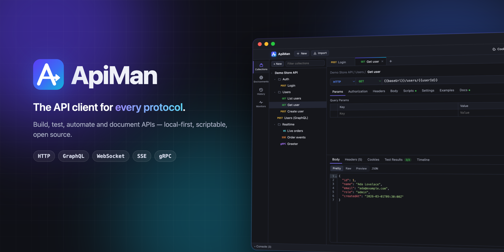
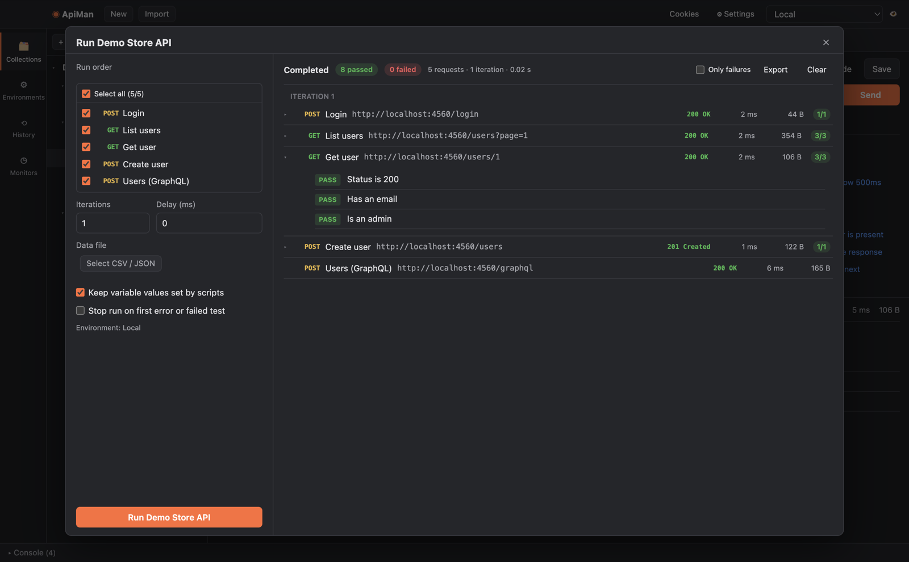
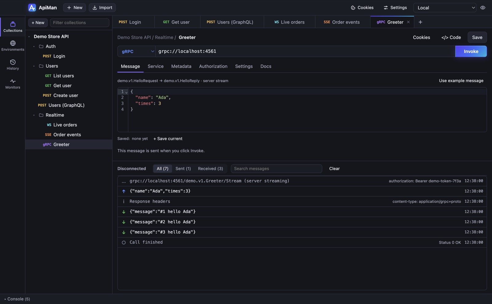
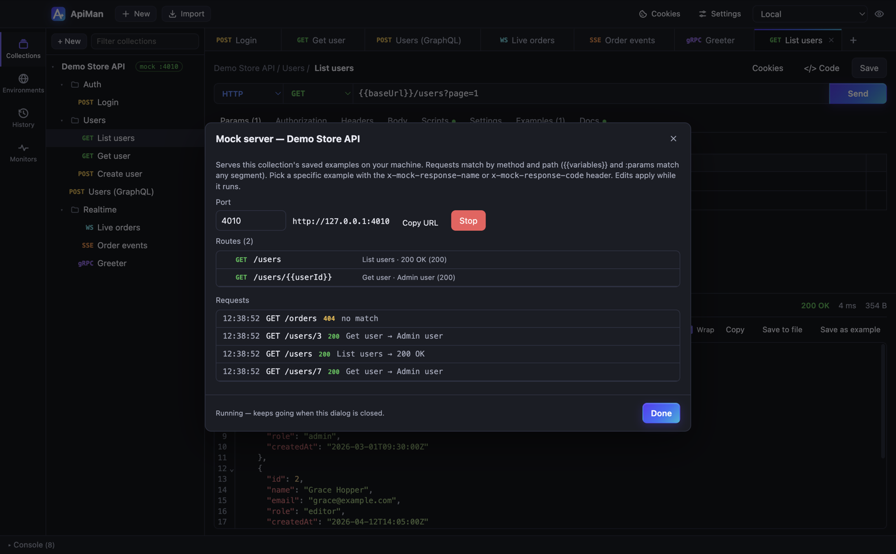

<p align="center">
  
</p>

<p align="center">
  <a href="https://github.com/gkravi/apiman/actions/workflows/ci.yml"></a>
  <a href="https://github.com/gkravi/apiman/releases/latest"></a>
  <a href="LICENSE"></a>
  <a href="https://gkravi.github.io/apiman/"></a>
</p>

<p align="center">
  <b>Build, test, automate and document APIs</b> — HTTP, GraphQL, WebSocket, Server-Sent Events and gRPC,<br>
  with scripting, tests, a collection runner, mock servers, monitors and a CLI.<br>
  Local-first: no account, no cloud, your data stays on your machine.
</p>

<p align="center">
  <a href="https://github.com/gkravi/apiman/releases/latest"><b>Download</b></a> ·
  <a href="https://gkravi.github.io/apiman/getting-started/">Getting started</a> ·
  <a href="https://gkravi.github.io/apiman/">Documentation</a> ·
  <a href="CHANGELOG.md">Changelog</a>
</p>

## Features

**Fast to use**
- **⌘K command palette**: fuzzy-jump to any request, tab, environment, history entry or command
- Light, dark and system themes; keyboard shortcuts throughout
- Bulk-edit params and headers as text; filter JSON responses with JSONPath

**Build requests**
- Every HTTP method and body type: JSON, XML, text, form-data with file uploads, URL-encoded, binary, GraphQL
- `{{variables}}` with environments, collection variables, globals and [dynamic values](docs/reference/dynamic-variables.md)
- Auth: Basic, Bearer, API key, Digest, AWS Signature V4, **OAuth 2.0** (authorization code + PKCE, client credentials, refresh) — inherited from folders and collections
- Paste a cURL command into the URL bar; generate cURL, fetch, axios or Python code

**Test and automate**
- Pre-request and post-response [scripts](docs/scripting.md) with the Postman-compatible `pm` API, Chai-style assertions, CryptoJS and Lodash — in a secure sandbox
- [Collection runner](docs/collection-runner.md) with iterations, CSV/JSON data files and flow control
- [`apiman` CLI](docs/cli.md) for CI with JUnit and JSON reports
- [Monitors](docs/monitors.md): scheduled runs with desktop alerts

**Beyond REST**
- [GraphQL](docs/graphql.md) with schema introspection and autocomplete
- [WebSocket and SSE](docs/realtime.md) with a live message log and saved messages
- [gRPC](docs/grpc.md) via `.proto` files or server reflection — unary and all streaming types

**Collaborate and ship**
- [Import](docs/import-export.md) Postman collections and environments, OpenAPI 3 / Swagger 2 (JSON or YAML) and cURL
- Save responses as examples and run a local [mock server](docs/mock-servers.md) from them
- Export single-page HTML [API documentation](docs/import-export.md#api-documentation) from your collections
- Cookie jar, proxy, custom CAs and client certificates ([network settings](docs/network.md))

<table>
  <tr>
    <td></td>
    <td></td>
  </tr>
  <tr>
    <td align="center">Collection runner</td>
    <td align="center">WebSocket</td>
  </tr>
  <tr>
    <td></td>
    <td></td>
  </tr>
  <tr>
    <td align="center">gRPC</td>
    <td align="center">Mock server</td>
  </tr>
</table>

## Install

Get the installer for your system from the [latest release](https://github.com/gkravi/apiman/releases/latest):
`.dmg` for macOS (Apple Silicon `arm64` or Intel `x64`), `Setup .exe` for Windows, `.AppImage` or `.deb`
for Linux. See [Getting started](docs/getting-started.md) for first-launch steps on unsigned builds.

## Command line

```bash
apiman run store.postman_collection.json -e staging.postman_environment.json -r cli,junit
apiman docs store.postman_collection.json -o store-api.html
```

See [Command-line runner](docs/cli.md) to install it and use it in CI.

## Build from source

```bash
git clone https://github.com/gkravi/apiman.git && cd apiman
npm ci
npm run dev      # run the app with hot reload
npm test         # run the test suite
npm run dist     # build installers for your OS into dist/
```

Requires Node.js 20+. See [CONTRIBUTING.md](CONTRIBUTING.md) for the full development guide and
[Architecture](docs/development/architecture.md) for how it fits together.

## Documentation

The [documentation website](https://gkravi.github.io/apiman/) (also browsable [here on GitHub](docs/README.md)) covers every feature, plus references for the
[scripting API](docs/reference/scripting-api.md), [CLI options](docs/reference/cli-options.md) and
[keyboard shortcuts](docs/reference/keyboard-shortcuts.md).

## Privacy and security

ApiMan has no accounts, telemetry or cloud sync. Requests go only where you send them, and everything
is stored in a local file with credentials encrypted by your OS keychain. Scripts from shared
collections run in a WebAssembly sandbox. See [Data, privacy and security](docs/data-and-security.md),
the [security audit](docs/security/audit.md) and the [enterprise deployment guide](docs/security/enterprise.md).
To report a vulnerability, see [SECURITY.md](SECURITY.md).

## License

[MIT](LICENSE) © 2026 ravi
