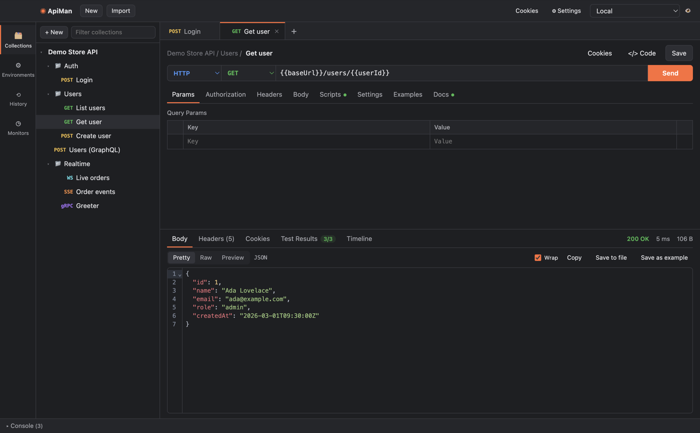

# ApiMan documentation

ApiMan is a desktop API client for building, testing, automating and documenting APIs. It speaks
HTTP, GraphQL, WebSocket, Server-Sent Events and gRPC, and runs on macOS, Windows and Linux.

## User guide

| Page | What it covers |
|---|---|
| [Getting started](getting-started.md) | Install, first request, the window at a glance |
| [Sending requests](requests.md) | URL and params, headers, bodies, settings, responses, code snippets |
| [Collections and folders](collections.md) | Organising requests, inheritance, history, tabs |
| [Variables and environments](variables.md) | `{{variables}}`, scopes, environments, globals, dynamic values, secrets |
| [Authentication](authentication.md) | Basic, Bearer, API key, Digest, AWS Signature, OAuth 2.0 |
| [Scripts and tests](scripting.md) | Pre-request and post-response scripts, `pm.test`, the console |
| [Collection runner](collection-runner.md) | Running collections, iterations, data files, flow control |
| [GraphQL](graphql.md) | Schema introspection, autocomplete, variables |
| [WebSocket and SSE](realtime.md) | Live connections, message log, saved messages |
| [gRPC](grpc.md) | Proto files, server reflection, all four call types |
| [Examples and mock servers](mock-servers.md) | Saving responses, serving them from a local mock |
| [Monitors](monitors.md) | Scheduled collection runs and failure notifications |
| [Cookies, proxies and certificates](network.md) | The cookie jar, proxy settings, CA and client certificates |
| [Import, export and documentation](import-export.md) | Postman, OpenAPI, cURL, HTML API docs |
| [Command-line runner](cli.md) | `apiman run` and `apiman docs` for CI |
| [Data, privacy and security](data-and-security.md) | Where data lives, the script sandbox, what leaves your machine |
| [Troubleshooting](troubleshooting.md) | Common problems and fixes |

## Reference

- [Scripting API (`pm`)](reference/scripting-api.md) — every object and method available in scripts
- [CLI options](reference/cli-options.md) — every `apiman` flag and exit code
- [Keyboard shortcuts](reference/keyboard-shortcuts.md)
- [Dynamic variables](reference/dynamic-variables.md)

## For developers

- [Architecture](development/architecture.md) — processes, the core library, the sandbox, data flow
- [Contributing](../CONTRIBUTING.md) — set up, run, test, code style
- [Releasing](development/releasing.md) — versioning, installers, signing and notarisation
- [Changelog](../CHANGELOG.md)
