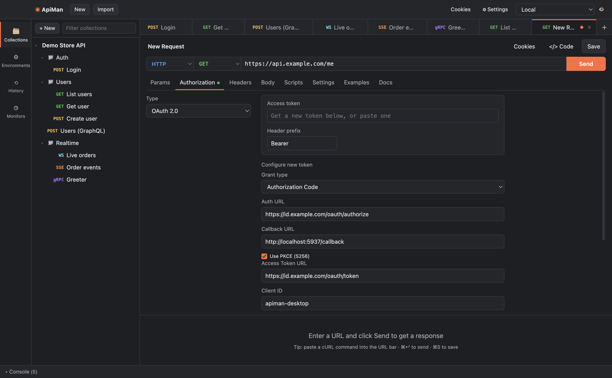

# Authentication

Set auth on the **Authorization** tab of a request, folder or collection. Every field accepts
`{{variables}}`, so keep secrets in an [environment](variables.md) rather than in the request.

| Type | What ApiMan sends |
|---|---|
| **Inherit auth from parent** | Whatever the nearest folder or the collection uses (the default for new requests) |
| **No Auth** | Nothing |
| **Basic Auth** | `Authorization: Basic base64(username:password)` |
| **Bearer Token** | `Authorization: Bearer <token>` |
| **API Key** | A header (e.g. `X-API-Key: …`) or a query parameter, your choice |
| **Digest Auth** | Answers the server's `401` Digest challenge automatically |
| **AWS Signature** | Signs the request with AWS Signature Version 4 |
| **OAuth 2.0** | `Authorization: <prefix> <access token>` for a token ApiMan fetches and stores |

An `Authorization` header you add yourself on the Headers tab takes precedence over Basic, Bearer
and OAuth 2.0.

## Digest Auth

Enter the username and password. ApiMan sends the request, reads the `WWW-Authenticate: Digest …`
challenge from the `401`, and retries once with the computed response. Supports `MD5`, `MD5-sess`
and `SHA-256`, with `qop=auth` and `auth-int`.

## AWS Signature (SigV4)

| Field | Example |
|---|---|
| Access Key | `{{aws_access_key_id}}` |
| Secret Key | `{{aws_secret_access_key}}` |
| AWS Region | `us-east-1` |
| Service Name | `execute-api`, `s3`, `lambda`, … |
| Session Token | Only for temporary credentials |

The request is signed after variables are resolved and re-signed on each redirect. For `s3`,
ApiMan also sends `X-Amz-Content-Sha256` and uses S3's single-encoding path rules. The
implementation is verified against AWS's published SigV4 test vectors.

## OAuth 2.0

The top box holds the **current access token**: it's what gets sent. You can paste a token there
directly, or configure ApiMan to fetch one and click **Get New Access Token**.

### Grant types

**Authorization Code** (with PKCE) — for signing in as a user.

1. Fill in **Auth URL**, **Access Token URL**, **Client ID**, (**Client Secret** if the app has one) and **Scope**.
2. Register the **Callback URL** (default `http://localhost:5937/callback`) with your provider as an
   allowed redirect URI. Nothing needs to listen on it: ApiMan catches the redirect inside its sign-in
   window before it loads.
3. Click **Get New Access Token**. A sign-in window opens on the provider's login page; sign in and approve.
4. The window closes and the token, its expiry and any refresh token are stored on the request.

PKCE (S256) is on by default and recommended. The sign-in window keeps its own cookies, so later
sign-ins to the same provider are usually instant. A `state` parameter protects against forged redirects.

**Client Credentials** — for machine-to-machine access. Needs the Access Token URL, Client ID and
Client Secret. No window opens.

**Password Credentials** — legacy grant using a username and password. Prefer Authorization Code.

### Other options

| Option | Notes |
|---|---|
| Client authentication | **Basic Auth header** (default, RFC 6749 §2.3.1) or **credentials in the body** — some providers require one or the other |
| Header prefix | `Bearer` by default |
| Refresh token | When the provider returned one, **Refresh token** gets a new access token without signing in again |
| Clear token | Forget the stored token |

The token's expiry is shown under it ("expires in 52 min"); expired tokens are flagged.

### Tips

- Put OAuth 2.0 on the **collection** and leave requests on *Inherit*: one sign-in covers every request.
- Token requests use the same cookie jar, proxy and certificate settings as your normal requests.
- Tested end to end against a standards-compliant OpenID Connect provider (`oidc-provider`),
  including PKCE, client secret Basic auth and refresh.
