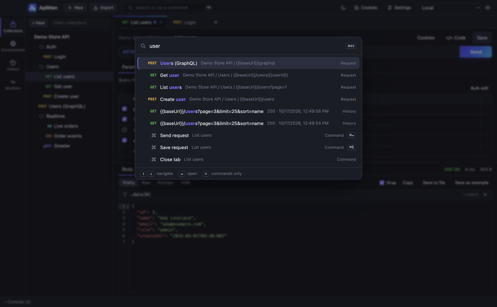
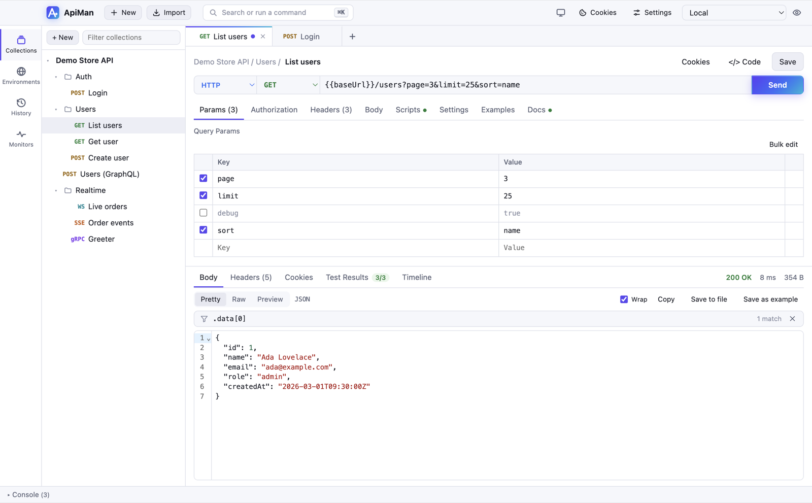

# Command palette and themes

## Command palette

Press **⌘K** (or **⌘P**; **Ctrl** on Windows and Linux), or click **Search or run a command** in the
top bar. Start typing to jump anywhere without touching the mouse.

It searches:

| Kind | What happens on ↵ |
|---|---|
| **Requests** in every collection (matched on name, folder path and URL) | Opens the request |
| **Open tabs** that aren't saved yet | Switches to the tab |
| **Environments** | Makes it the active environment |
| **Commands** — send, save, new request, import, generate code, close tab, show/hide console, cookies, settings, theme, run or mock any collection, collection settings, globals, switch sidebar view | Runs it |
| **History** — your 30 most recent requests | Opens a copy |

Matching is fuzzy: letters must appear in order, and word starts count most. `gu` finds
**G**et **u**ser, `lu` finds **L**ist **u**sers, and `stag` finds *Use environment: **Stag**ing*.
Matched letters are highlighted.

| Key | Action |
|---|---|
| **↑ / ↓** | Move the selection |
| **↵** | Open / run |
| **Esc** | Close |
| Type **`>`** first | Show commands only, like VS Code |

## Themes

ApiMan has a dark and a light theme, sharing the same brand colours.

- **System** (default) follows your operating system, and switches automatically when it does.
- **Light** or **Dark** fixes the theme.

Change it with the theme button in the top bar (it cycles System → Light → Dark), under
**Settings → Appearance**, or from the command palette (**Theme: …**). The choice is remembered
on this computer.
