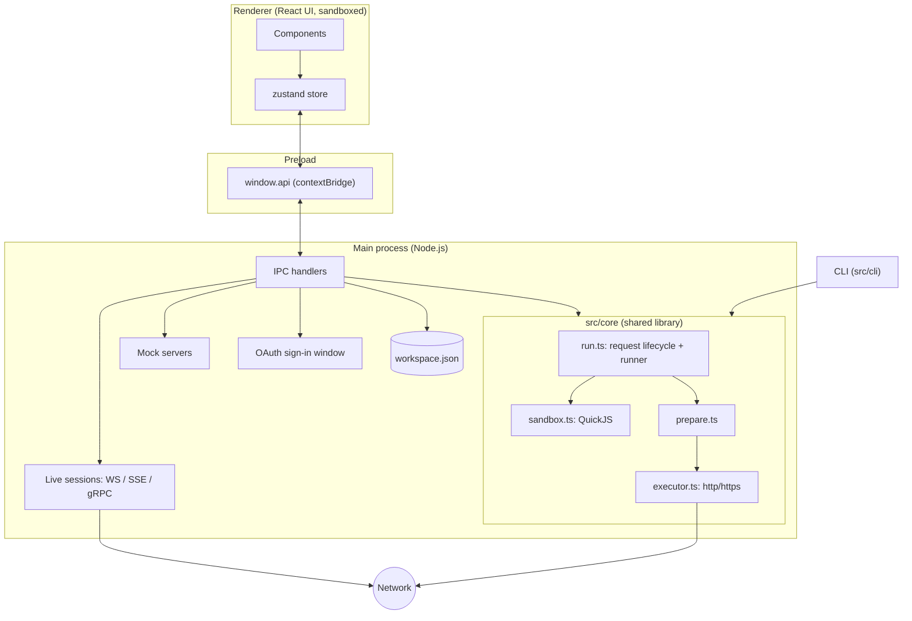

# Architecture

ApiMan is an Electron app written in TypeScript. The important design decision: **all networking,
script execution and file access happen in Node.js (the main process or the CLI), never in the web
page.** That's what lets an API client send arbitrary headers without CORS, run untrusted scripts
safely, and share one engine between the desktop app and the command line.

## Processes

| Process | Code | Role |
|---|---|---|
| **Renderer** | `src/renderer/src` | React UI and app state (zustand). Runs with context isolation and sandboxing; no Node.js |
| **Preload** | `src/preload` | Exposes a fixed, typed `window.api` to the renderer (`api.d.ts` is the contract) |
| **Main** | `src/main` | Window, IPC handlers, workspace storage, live connections, mock servers, OAuth sign-in window, notifications |
| **CLI** | `src/cli` | `apiman run` / `apiman docs`, bundled into one Node script |

The renderer owns the workspace in memory and saves it (debounced) through `window.api.saveWorkspace`.
Everything that needs the network goes through the main process.

## The core library (`src/core`)

Pure TypeScript shared by every process. Files fall into two groups:

**Pure** (safe in the renderer): `types` (the data model), `factory`, `variables`, `url`, `prepare`,
`tree`, `curl`, `postman`, `openapi`, `codegen`, `cookies`, `varsync`, `graphql`, `sse` (parser),
`mockRoutes`, `markdown`, `docs`.

**Node-only** (main process and CLI): `executor`, `run`, `sandbox`, `sandbox-prelude`, `sandbox-libs`,
`digest`, `awsv4`, `oauth2`, `realtime`, `grpc`, `grpc-reflection`, `mock`.

`tsconfig.web.json` excludes the Node-only files, so importing one from the renderer fails the typecheck.

## Lifecycle of a request

`run.ts → runRequest()` is the single path for sends, runner steps, monitors and the CLI:

1. **Pre-request scripts** run in the sandbox (collection → folders → request). They can change
   variables and the request itself.
2. **Prepare** (`prepare.ts`): resolve `{{variables}}` with scope priority, normalise the URL,
   apply auth (Basic, Bearer, API key and OAuth 2.0 become headers; Digest and SigV4 are passed to the
   executor), and encode the body.
3. **Execute** (`executor.ts`): Node `http`/`https` with a fresh socket per request (so timings are
   real). Per hop: add cookies from the jar, sign SigV4, apply proxy (absolute URI or CONNECT tunnel)
   and TLS options (extra CA, client certificate), follow redirects, answer a Digest challenge,
   store `Set-Cookie`, decompress gzip/deflate/brotli, record DNS/connect/TLS/TTFB/download timings.
4. **Post-response scripts** run with `pm.response`.
5. The result returns updated variables and cookies; the renderer writes them back to the workspace.

`runCollection()` loops `runRequest` over steps and iterations, carrying variables and cookies forward
and handling `setNextRequest`, delays, data rows and stop-on-error.

## The script sandbox

`sandbox.ts` creates a fresh [QuickJS](https://github.com/justjake/quickjs-emscripten) (WebAssembly)
runtime per script with a 64 MB memory limit, a 1 MB stack and a 5 s CPU deadline per evaluation step.

- **State in, state out.** The host injects plain JSON (`__state`: variables, request, response,
  cookies, info) and reads it back with `__export()` when the script finishes. No live host objects
  cross the boundary.
- **The `pm` API is written in JavaScript** (`sandbox-prelude.ts`) and evaluated inside the
  sandbox. The host exposes only four functions: log, `sendRequest`, `require` (returns embedded
  library source) and secure random bytes.
- **`pm.sendRequest`** queues a request; the host performs it with the normal executor after the
  script yields, then calls back into the sandbox. Callbacks can send more, up to 25 per script.
- **Scripts are async functions**, so `await` works; rejections after an `await` are captured and
  reported with line numbers.
- **Libraries** (`crypto-js`, `lodash`) are imported as raw source at build time (`?raw`) and
  evaluated lazily on first `require`.

## Live connections

`realtime.ts` (WebSocket via `ws`, SSE via the executor's `openClientRequest` and `sse.ts`) and
`grpc.ts` (`@grpc/grpc-js`) open sessions that emit `StreamEvent`s. The main process keys sessions by
an id the renderer chooses and forwards events on the `rt:event` channel; the store appends them to
the owning tab's log. Sessions close when their tab closes or the window goes away.

gRPC definitions come from `.proto` files (`@grpc/proto-loader` for calling, `protobufjs` reflection
for example messages) or from server reflection (`grpc-reflection.ts` speaks the reflection protocol
directly and builds a `FileDescriptorSet`).

## Storage

`src/main/storage.ts` reads and writes `workspace.json` in Electron's `userData` directory, writing
to a temp file and renaming for atomicity, with writes queued so they never interleave. Set
`APIMAN_USER_DATA=/some/dir` to run an instance against a different folder (used for testing).

## Security boundaries

- Renderer: `contextIsolation`, `sandbox`, no `nodeIntegration`, a strict CSP, `will-navigate` and
  `setWindowOpenHandler` guards that send external links to the system browser.
- HTML previews: `<iframe sandbox="">` with `srcdoc`.
- Markdown: escaped before formatting, link schemes allow-listed.
- Scripts: QuickJS sandbox as above.
- OAuth sign-in: its own window and session partition (`persist:apiman-oauth`); the redirect is
  intercepted, never loaded.

## Build

| Tool | Builds |
|---|---|
| `electron-vite` | `out/main`, `out/preload`, `out/renderer`. Dependencies are external to the main bundle except `crypto-js`/`lodash` (inlined as source for the sandbox) |
| `vite.cli.config.ts` | `out/cli/apiman.cjs`, a single CommonJS file |
| `electron-builder` | Installers from `out/` + production `node_modules` (`electron-builder.config.cjs`); QuickJS's `.wasm` is kept outside the asar archive |

Renderer-only packages (React, CodeMirror, GraphQL, …) are `devDependencies` because they're bundled;
`dependencies` holds only what the main process and CLI load at runtime.
