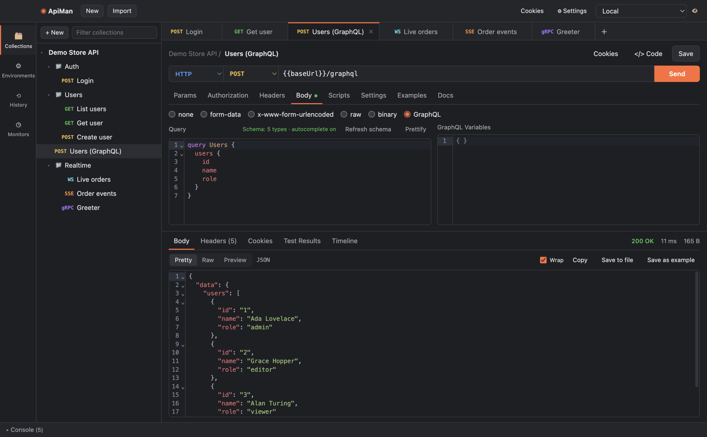

# GraphQL

GraphQL requests are ordinary HTTP requests with the **GraphQL** body mode: ApiMan sends
`{"query": …, "variables": …}` as JSON with `POST`.



## Writing a query

1. Set the method to `POST` and the URL to your GraphQL endpoint (e.g. `{{baseUrl}}/graphql`).
2. On the **Body** tab choose **GraphQL**.
3. Write the query on the left and the variables (JSON) on the right.

```graphql
query User($id: ID!) {
  user(id: $id) {
    id
    name
    email
  }
}
```

```json
{ "id": "{{userId}}" }
```

`{{variables}}` work in both panes. If the variables pane isn't valid JSON, ApiMan tells you before
sending instead of sending a broken request.

## Schema, autocomplete and validation

Click **Fetch schema**. ApiMan sends the standard introspection query to the same URL, using the
request's headers, auth, cookies and proxy settings — so it works with authenticated APIs. Then:

- **Autocomplete**: suggestions for fields, arguments and types as you type, or with **Ctrl+Space**.
- **Validation**: unknown fields and wrong argument types are underlined.
- The status line shows how many types the schema has. **Refresh schema** re-fetches it.

The schema is kept for the tab while the app is open. If the server has introspection disabled,
you'll see why (e.g. "no __schema in response"); queries still work, just without autocomplete.

**Prettify** reformats the query.

## Tips

- Put GraphQL requests in a collection with collection-level auth so every query shares the token.
- Tests work as usual: `pm.expect(pm.response.json().data.user.name).to.equal('Ada')`.
- Check `errors` explicitly — GraphQL APIs usually return `200` even for failed queries:

  ```js
  pm.test('No GraphQL errors', () => pm.expect(pm.response.json().errors).to.be.undefined)
  ```
