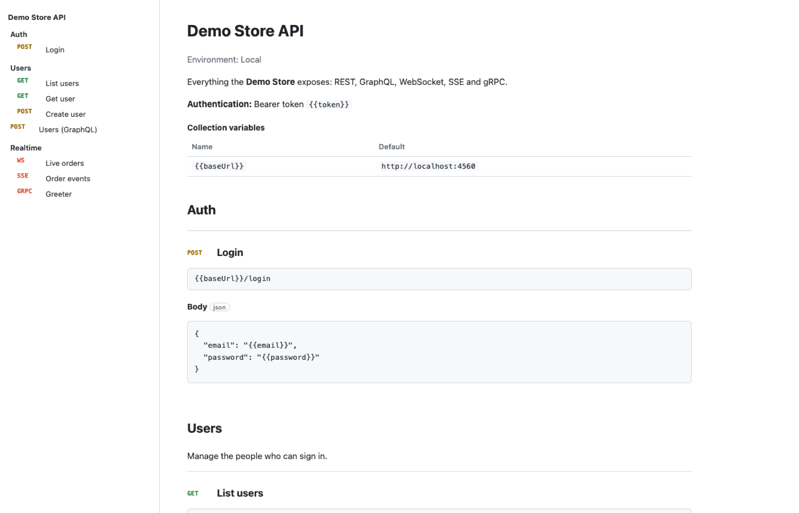
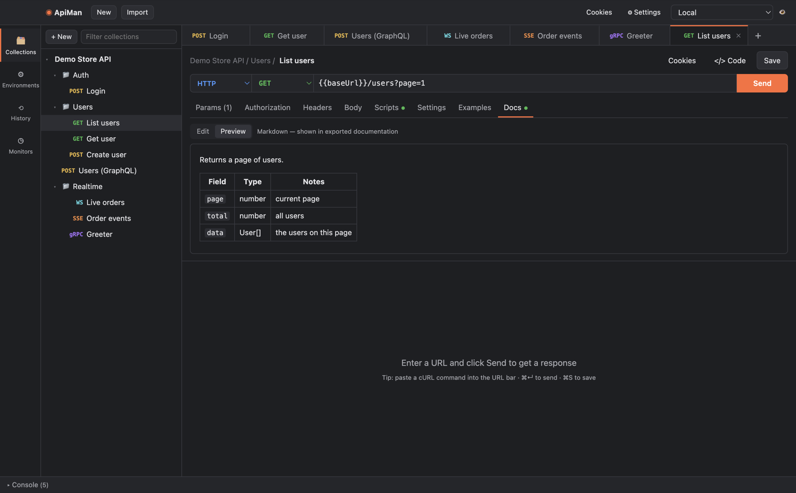

# Import, export and documentation

## Importing

Click **Import** (or **⌘O** / **Ctrl+O**), then paste text or **Choose file…**. ApiMan detects the format:

| Format | Becomes |
|---|---|
| **Postman collection** v2.0 / v2.1 (`.json`) | A collection with folders, requests, auth, variables, scripts, examples and descriptions |
| **Postman environment** (`.json`) | An environment (secret-typed values stay secret) |
| **OpenAPI 3.x** or **Swagger 2.0** (JSON or YAML) | A collection — see below |
| **cURL command** | A new request tab |

You can also paste a cURL command straight into a request's URL bar.

### From Postman

In Postman, export each collection (**⋯ → Export → Collection v2.1**) and environment
(**Environments → ⋯ → Export**), then import the files into ApiMan.

What carries over: requests (all body types), headers, params including disabled ones, auth
(Basic, Bearer, API key; other types fall back to *Inherit*), collection variables, pre-request and
test scripts at every level, saved responses (as examples) and descriptions.

### From OpenAPI / Swagger

- One **folder per tag**, in the spec's tag order; untagged operations at the top level.
- A `{{baseUrl}}` collection variable from the first server (server variables filled with their
  defaults), or `scheme://host/basePath` for Swagger 2.
- Path parameters become `{{variables}}` with collection variables holding their example values.
- Required query parameters are enabled; optional ones are added but disabled. Same for headers.
- Request bodies are generated from the schema (or the spec's example): JSON, form-urlencoded,
  multipart (file fields as file rows) or XML. `$ref`, `allOf`, `oneOf`/`anyOf`, enums and formats
  (`date-time`, `email`, `uuid`, …) are handled.
- Collection auth from the security scheme: Bearer, Basic, Digest, API key or OAuth 2.0 (with the
  flow's URLs and scopes). Operations with `security: []` get **No Auth**.
- Operation and API descriptions become request and collection [docs](#api-documentation).

## Exporting

- **Collection:** **⋯ → Export (Postman v2.1)** — opens in Postman, Newman, ApiMan's CLI and most
  other tools.
- **Environment:** Environments sidebar → **⋯ → Export**.
- **Runner results:** **Export** in the runner saves JSON.

## API documentation

ApiMan can turn a collection into a single-page HTML API reference you can host anywhere or send
to someone.



### Writing docs

Each request, folder and collection has a **Docs** tab where you write Markdown. **Preview** shows how
it renders.



Supported Markdown: headings, paragraphs, **bold**, *italic*, ~~strike~~, `code`, fenced code blocks,
links (http, https, mailto and `#anchors`), bullet and numbered lists, blockquotes, horizontal rules
and tables. Raw HTML is shown as text, never rendered, so imported descriptions can't inject markup.

Descriptions on individual query parameters and headers (for example from an OpenAPI or Postman
import) appear in the docs' parameter tables too.

### Exporting docs

**⋯ → Export documentation (HTML)** on a collection, or with the CLI:

```bash
apiman docs store.postman_collection.json -o store-api.html
```

The page includes:

- the collection description, authentication and variables,
- navigation by folder,
- for each request: method, URL, description, effective auth (marked *inherited* where it is),
  query parameters, headers, body and saved examples,
- light and dark themes following the reader's system setting, and a mobile-friendly layout.

It's one self-contained file with no external assets — publish it with GitHub Pages, any static host,
or attach it to an email.
