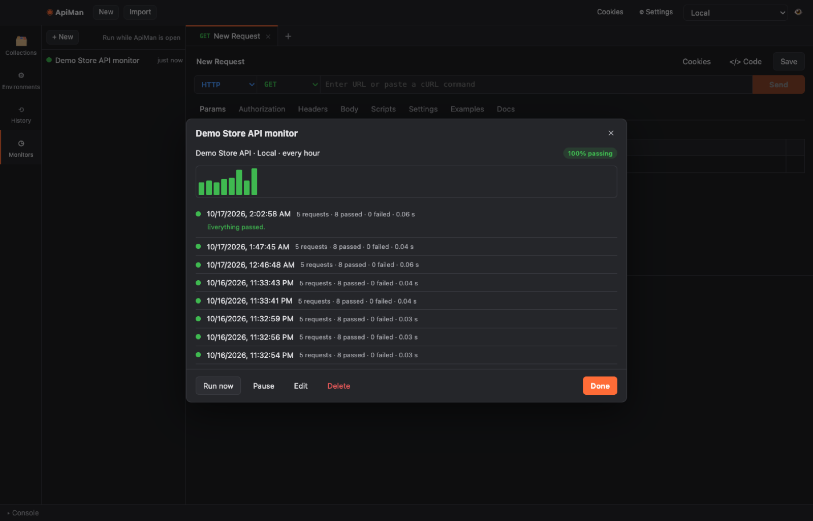

# Monitors

A monitor runs a collection on a schedule and tells you when something breaks — handy for keeping an
eye on a staging API or an integration you depend on.



## Creating a monitor

1. Open **Monitors** in the sidebar rail and click **+ New**.
2. Choose:

   | Field | Notes |
   |---|---|
   | Name | Shown in the list and in notifications |
   | Collection | The collection to run (all of its HTTP requests) |
   | Environment | Which environment's variables to use — independent of the one active in the app |
   | Schedule | Every 5, 15 or 30 minutes, hourly, every 6 hours, or daily |
   | Desktop notification when a run fails | On by default |
   | Enabled | Untick to pause |

3. Click **Create & run**. The first run starts straight away.

## What a run does

A monitor run is a normal [collection run](collection-runner.md) with one iteration, using the
monitor's environment, the collection's variables and your globals. It passes when every test passes
and no request fails.

Monitors are deliberately hands-off: **a run never changes your variables or cookies**, so a monitor
can't log you out or overwrite a token you're working with.

## History and alerts

Click a monitor to see:

- its pass rate and a bar per run (green passed, red failed; height is duration),
- every run with requests, passed and failed tests, errors and duration,
- for failed runs, exactly what failed, e.g.
  `Flaky — is up: expected response to have status code 200 but got 503 Service Unavailable`.

The last 50 runs are kept. **Run now**, **Pause**/**Resume**, **Edit** and **Delete** are at the bottom.

When a run fails and notifications are on, you get a desktop notification with the first few
failures. Clicking it brings ApiMan to the front.

## When monitors run

Monitors run **while ApiMan is open** (it can be in the background or minimised). ApiMan checks
every 30 seconds which monitors are due, starting a few seconds after launch — so a monitor that
was due while the app was closed runs once shortly after you open it.

For round-the-clock monitoring, run the collection with the [CLI](cli.md) from a scheduler such as
cron, launchd, Windows Task Scheduler or a CI schedule:

```bash
# crontab: every 15 minutes, keep a JUnit report per run
*/15 * * * * cd ~/api-checks && apiman run store.postman_collection.json -e prod.postman_environment.json -r cli,junit --reporter-junit-export "reports/$(date +\%s).xml"
```
