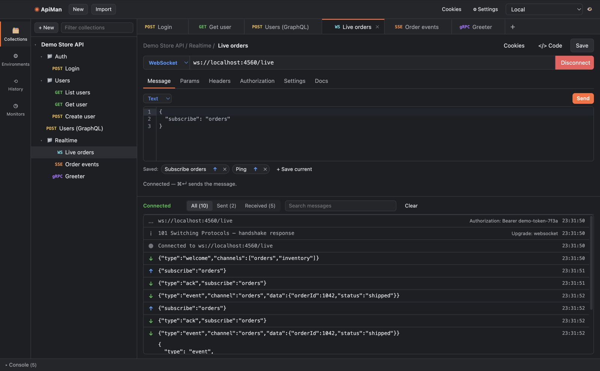
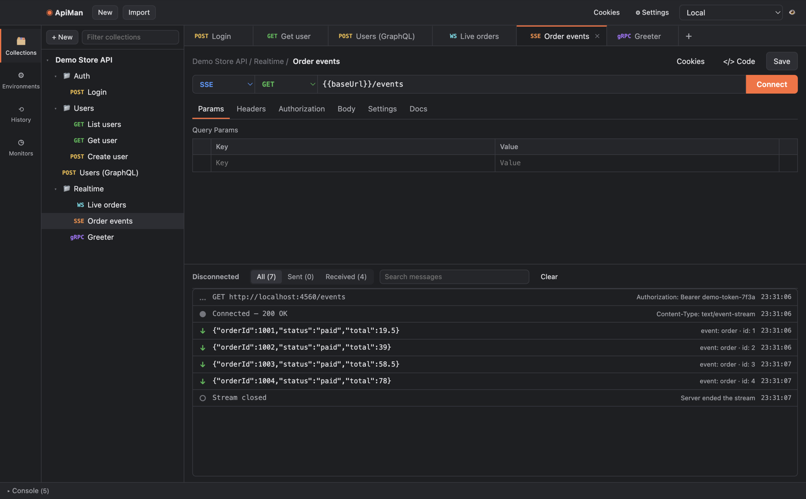

# WebSocket and Server-Sent Events

Choose **WebSocket** or **SSE** in the protocol dropdown at the left of the URL bar. Instead of one
response, you get a live **message log**.

## WebSocket

1. Enter a `ws://` or `wss://` URL (an `http(s)://` URL is converted for you).
2. Add headers, query params and auth as for any request — they're sent with the handshake.
   Auth works the same, including inheriting from the collection.
3. Click **Connect**. The log shows the handshake, then `● Connected`.
4. Type a message in the **Message** tab and click **Send** (or **⌘↵** / **Ctrl+↵**).
5. **Disconnect** closes the connection with code 1000.

### Saved messages

Messages you send often can be saved with the request: **+ Save current** stores the composer's
text under a name. Click a saved message to load it into the composer, or its **↑** to send it
immediately. They're saved with the request like any other field.

### Settings

- **Sub-protocols** (Settings tab) — comma-separated, sent as `Sec-WebSocket-Protocol`. The one the
  server picks is shown when the connection opens.
- **Connect timeout** — how long to wait for the handshake.
- **Verify SSL certificates** — for `wss://` servers with self-signed certificates.

Proxy, client certificate and cookie settings apply to WebSocket connections too.

## Server-Sent Events (SSE)

SSE requests are HTTP requests whose response is a stream of events (`text/event-stream`). Pick
**SSE**, enter the URL, and click **Connect**. Each event appears in the log with its event name and
id, if any.

- Any method and body work, so streaming APIs that use `POST` with a JSON body (such as LLM
  completion endpoints) work too.
- `Accept: text/event-stream` and `Cache-Control: no-cache` are added unless you set them.
- If the server answers with something that isn't an event stream (say a `401` JSON error), the log
  shows the status, headers and body so you can see why.
- The timeout only applies to connecting; a healthy stream can stay idle as long as it likes.
- SSE is one-way: there's nothing to send.

## The message log

Shared by WebSocket, SSE and [gRPC](grpc.md):

| Icon | Meaning |
|---|---|
| `…` | Connecting (click to see the request headers) |
| `i` | Information, such as the handshake response and its headers |
| `●` | Connected |
| `↑` | Sent by you |
| `↓` | Received |
| `✕` | Error |
| `○` | Closed, with the close code or reason |

- **All / Sent / Received** filter the log; **Search messages** filters by text.
- Click a row to expand it: JSON is pretty-printed, and **Copy** copies the raw message.
- Binary frames are shown as base64 with their size.
- The log keeps the latest 2000 entries per tab. **Clear** empties it.
- The view follows new messages unless you've scrolled up to read older ones.

Live connections aren't part of [collection runs](collection-runner.md) or the [CLI](cli.md).
