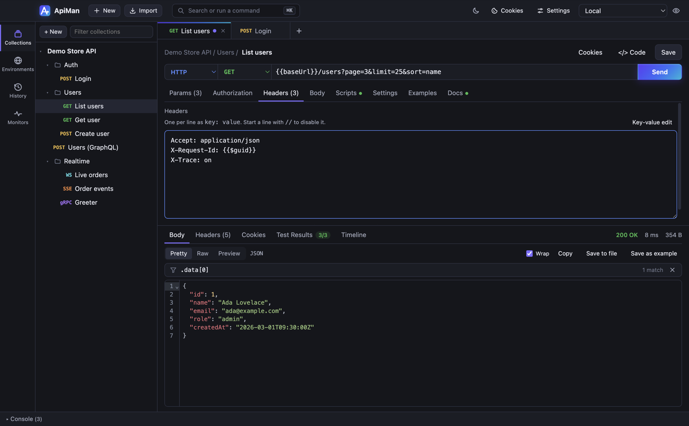
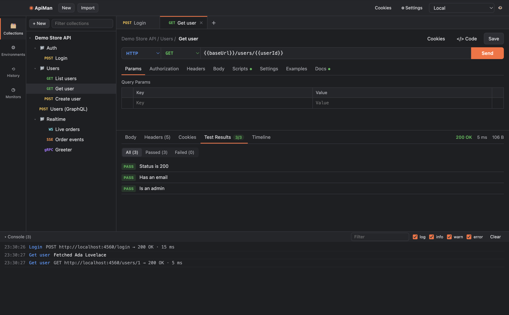
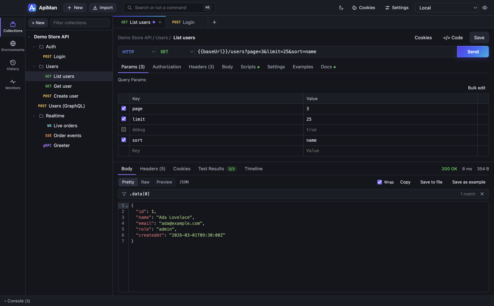

# Sending requests

Every request has a **protocol** (HTTP, WebSocket, SSE or gRPC — see [WebSocket and SSE](realtime.md)
and [gRPC](grpc.md) for the live ones), a **method** and a **URL**. This page covers HTTP.

## URL and query parameters

The URL bar and the **Params** table stay in sync: typing `?page=2&q=api` fills the table, and editing
the table rewrites the URL.

- **Untick** a parameter to keep it in the table but leave it out of the URL.
- Values are URL-encoded when sent; `{{variables}}` stay readable in the editor.
- A URL without a scheme gets `http://` — `localhost:3000/users` just works.
- Hover the URL to see it with all variables resolved. Unresolved variables are listed under the URL bar.

**Paste a cURL command** into the URL bar to import it: method, URL, headers, body, `-u` basic auth,
`-k` (skip TLS verification) and `-L` (follow redirects) are all understood.

### Bulk edit

Click **Bulk edit** above the Params, Headers or URL-encoded body table to edit it as text, one
`key: value` per line (`key=value` works too). Start a line with `//` (or `#`) to keep it but disable
it. It's the quickest way to paste a block of headers copied from browser dev tools. Edits apply as
you type; **Key-value edit** switches back.

## Headers

Add headers in the **Headers** table (or [bulk edit](#bulk-edit) them); untick to disable one temporarily. When you don't set them,
ApiMan adds:

| Header | Value |
|---|---|
| `Content-Type` | Matches the body type (e.g. `application/json` for a JSON raw body) |
| `User-Agent` | `ApiMan/<version>` |
| `Accept` | `*/*` |
| `Accept-Encoding` | `gzip, deflate, br` (responses are decompressed for you) |
| `Cookie` | Cookies from the [cookie jar](network.md#cookies) that match the URL |

## Body

| Mode | Use it for |
|---|---|
| **none** | GET, DELETE and other requests without a body |
| **form-data** | `multipart/form-data` — text fields and file uploads (choose **File** in the row to pick a file) |
| **x-www-form-urlencoded** | Classic HTML form posts |
| **raw** | JSON, Text, XML, HTML or JavaScript — pick the language for syntax highlighting and the right `Content-Type`. **Beautify** formats JSON |
| **binary** | Send a file's bytes as the whole body |
| **GraphQL** | A query plus variables — see [GraphQL](graphql.md) |

Variables work everywhere in the body, including inside JSON strings: `{"id": "{{userId}}"}`.

## Settings

Per-request options on the **Settings** tab:

| Setting | Default | Notes |
|---|---|---|
| Automatically follow redirects | On | 301/302/303 switch to GET as browsers do; 307/308 keep method and body |
| Max redirects | 10 | |
| Verify SSL certificates | On | Turn off for self-signed development servers |
| Timeout (ms) | 30000 | Gives up when the connection has been idle (no data either way) for this long |

When a redirect goes to a different host, the `Authorization` header is dropped so credentials aren't
leaked to the new host.

## The response

| Tab | Shows |
|---|---|
| **Body** | **Pretty** (formatted, syntax-highlighted), **Raw**, or **Preview** (rendered HTML in a sandboxed frame). Images display inline; other binary responses can be saved to a file |
| **Headers** | Every response header in the order received |
| **Cookies** | Cookies the response set, with domain, path, expiry and flags |
| **Test Results** | Results of `pm.test(...)` from your scripts — see [Scripts and tests](scripting.md) |
| **Timeline** | DNS, TCP connect, TLS handshake, time to first byte and download, plus the redirect chain |

The status line shows the status code (coloured by class), total time (hover for the breakdown) and size.

### Filtering JSON responses

For JSON responses, a filter box sits above the body. Type a [JSONPath](https://goessner.net/articles/JsonPath/)
expression and the body shows only what matches, with a match count:

| Filter | Shows |
|---|---|
| `$.data[*].email` | Every user's email |
| `$..id` | Every `id`, at any depth |
| `$.items[?(@.price < 10)].name` | Names of items under 10 |
| `$.items[?(@.tags && @.status == 'live')]` | Items with tags that are live |
| `$.users[?(@.name =~ /^a/i)]` | Users whose name starts with "a" |
| `$.data[0]`, `$.data[-1]`, `$.data[:3]` | First, last, first three |
| `.data[0].name` | jq-style paths work too |

Filters support names, `['quoted names']`, indexes (negative from the end), `*`, `..` (any depth),
unions `[0,2]`, slices `[start:end:step]`, and `?()` filters with `==` `!=` `<` `<=` `>` `>=`,
`=~ /regex/`, `&&`, `||` and `!`. A mistake shows what's wrong (e.g. "Unclosed [") instead of a result.
The filter stays in place when you send the request again, so you can keep watching one field.

Response tools:

- **Copy** — copy the body.
- **Save to file** — save the body to disk (works for binary responses too).
- **Save as example** — keep this response on the request; mock servers can serve it.
  See [Examples and mock servers](mock-servers.md).
- **Wrap** — toggle line wrapping. **⌘F** / **Ctrl+F** searches inside the body.

Responses larger than 50 MB are refused rather than freezing the app.

## Code snippets

Click **`</> Code`** to turn the current request (variables resolved, auth applied) into code:

- cURL
- JavaScript — `fetch`
- Node.js — `axios`
- Python — `requests`

Secrets appear in plain text in snippets, so check before sharing them.
