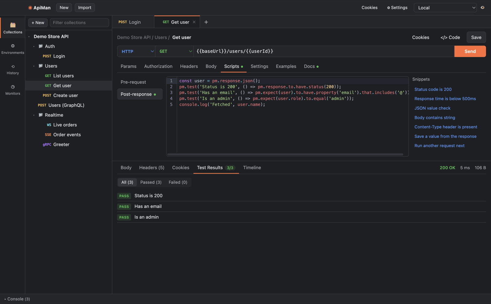

# Scripts and tests

Scripts are JavaScript that runs **before** a request is sent (pre-request) and **after** the
response arrives (post-response). Use them to compute values, chain requests together, and write
tests. They use the same `pm` API as Postman, so most existing Postman scripts work unchanged.



## Where scripts go

Open the **Scripts** tab on a request (or a folder/collection's settings) and choose
**Pre-request** or **Post-response**. The **Snippets** list on the right inserts common patterns.

Scripts on collections and folders run around every request inside them, outermost first — see
[inheritance order](collections.md#inheritance-order).

## Writing tests

```js
pm.test('Status is 200', () => {
  pm.response.to.have.status(200)
})

pm.test('Returns the user', () => {
  const user = pm.response.json()
  pm.expect(user).to.have.property('email').that.includes('@')
  pm.expect(user.role).to.be.oneOf(['admin', 'editor'])
})

pm.test('Fast enough', () => {
  pm.expect(pm.response.responseTime).to.be.below(500)
})
```

Results appear in the **Test Results** tab (with a passed/total badge), in the runner, and in CLI
reports. A failing assertion shows its message, e.g. `expected 'viewer' to be one of ['admin', 'editor']`.

`pm.expect` supports the common Chai-style assertions: `equal`, `eql` (deep), `include`, `a`/`an`,
`property` (including nested `a.b[0].c`), `lengthOf`, `above`/`below`/`within`, `match`, `oneOf`,
`keys`, `members`, `ok`/`true`/`false`/`null`/`undefined`/`exist`/`empty`, `throw`, with `not` and
`deep`. See the [full API reference](reference/scripting-api.md).

## Common recipes

**Save a token from a login response**

```js
pm.environment.set('token', pm.response.json().token)
```

**Add a computed header before sending**

```js
const ts = String(Date.now())
pm.request.headers.upsert({ key: 'X-Timestamp', value: ts })
pm.request.headers.upsert({ key: 'X-Signature', value: CryptoJS.HmacSHA256(ts, pm.environment.get('apiSecret')).toString() })
```

**Fetch something first with `pm.sendRequest`**

```js
const res = await pm.sendRequest({
  url: pm.environment.get('baseUrl') + '/auth/token',
  method: 'POST',
  header: { 'Content-Type': 'application/json' },
  body: { mode: 'raw', raw: JSON.stringify({ clientId: pm.environment.get('clientId') }) }
})
pm.environment.set('token', res.json().access_token)
```

(The callback form `pm.sendRequest(req, (err, res) => { … })` works too.)

**Skip a request or change what runs next** (in the runner)

```js
if (!pm.environment.get('featureEnabled')) pm.execution.skipRequest()
pm.execution.setNextRequest('Get user')   // jump to a request by name
pm.execution.setNextRequest(null)         // stop the run
```

## Libraries

Available without installing anything:

| Name | How |
|---|---|
| CryptoJS | Global `CryptoJS`, or `require('crypto-js')` — hashes, HMAC, AES, Base64… |
| Lodash | Global `_`, or `require('lodash')` |
| uuid | `require('uuid').v4()` |
| atob / btoa | Globals |
| Secure random | `crypto.getRandomValues()`, `crypto.randomUUID()` |

## The console

Open **Console** at the bottom of the window. It shows every request sent (method, final URL,
status, time) and everything scripts print with `console.log/info/warn/error`. Objects are printed
as formatted JSON. Filter by level or text; **Clear** empties it.

## The sandbox

Scripts run in an isolated JavaScript interpreter (QuickJS compiled to WebAssembly), not in Node or
the app itself:

- No access to files, the network, environment variables or other apps. `require('fs')` and other
  Node modules fail with "Cannot find module".
- The only way out is `pm.sendRequest`, which goes through ApiMan's normal request pipeline.
- Each script step gets 5 seconds of CPU time (an infinite loop is stopped with "Script timed out")
  and 64 MB of memory. A script can make up to 25 `pm.sendRequest` calls.

That makes it safe to run scripts from imported collections you didn't write.

### Errors

A syntax or runtime error is reported with its line number, e.g.
`Pre-request script: ReferenceError: 'tokn' is not defined (line 3)`.

- A **pre-request** error stops the request from being sent.
- A **post-response** error stops later test scripts, but tests that already ran are kept.

## Compatibility notes

- Variables are stored as strings. `pm.environment.set('n', 5)` stores `"5"`; objects are stored as JSON.
- `setTimeout` isn't available. Use `await pm.sendRequest(...)` for sequencing.
- `pm.cookies` gives read access to cookies for the request URL; `pm.cookies.jar()` isn't supported.
- `postman.setEnvironmentVariable`, `postman.getEnvironmentVariable`, `postman.setGlobalVariable` and
  `postman.setNextRequest` are supported for older scripts. The legacy `tests['name'] = true` syntax isn't.
