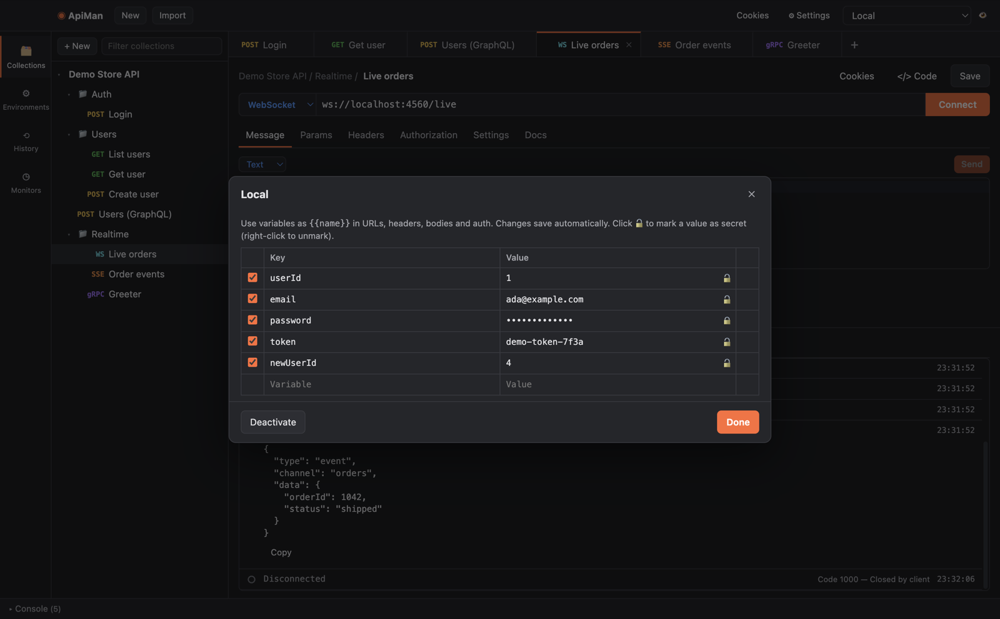

# Variables and environments

Write `{{name}}` anywhere — URL, params, headers, body, auth fields, even inside other variables — and
ApiMan substitutes the value when the request is sent.



## Where variables come from

From highest to lowest priority (the first one that defines a name wins):

| Scope | Set in | Lifetime |
|---|---|---|
| **Local** | `pm.variables.set()` in a script | One request (one run step in the runner) |
| **Data** | A CSV/JSON data file in the [collection runner](collection-runner.md) | One iteration |
| **Environment** | The active environment | Saved |
| **Collection** | The collection's Variables tab | Saved |
| **Globals** | Environments sidebar → **Globals** | Saved |

Plus [dynamic variables](reference/dynamic-variables.md) such as `{{$guid}}` and `{{$timestamp}}`,
which produce a fresh value every time.

## Environments

An environment is a named set of variables — typically one per deployment (Local, Staging, Production).

- Create one in the **Environments** sidebar with **+ New**.
- Pick the active environment in the top-right dropdown. **No Environment** is fine too.
- The 👁 button next to it opens the active environment (or Globals when none is active) for editing.
- Changes save as you type.

The same request then works everywhere: `{{baseUrl}}/users/{{userId}}` resolves differently per environment.

## Secrets

Click 🔓 next to a value to mark it secret (🔒): it's masked in the editor (click the lock to reveal it
temporarily, right-click to unmark). Secret values are still stored in your workspace file on disk —
see [Data, privacy and security](data-and-security.md).

## Nested and computed values

- Variables can reference variables: `baseUrl = https://{{host}}/v{{apiVersion}}`.
- Names can be built from variables: `{{token_{{env}}}}` picks `token_dev` or `token_prod`.
- Unknown variables are left as `{{name}}` and listed in a warning under the URL bar, so typos are easy to spot.

## Setting variables from scripts

```js
// Post-response script on a login request
const { token } = pm.response.json()
pm.environment.set('token', token)       // saved to the active environment
pm.collectionVariables.set('lastLogin', new Date().toISOString())
pm.variables.set('tmp', 'only for this request')
```

Values a script sets are written back to the environment, collection or globals when the request
finishes (and, in the runner, when the run finishes — unless you turn off *Keep variable values*).
Non-string values are stored as strings: objects become JSON.
